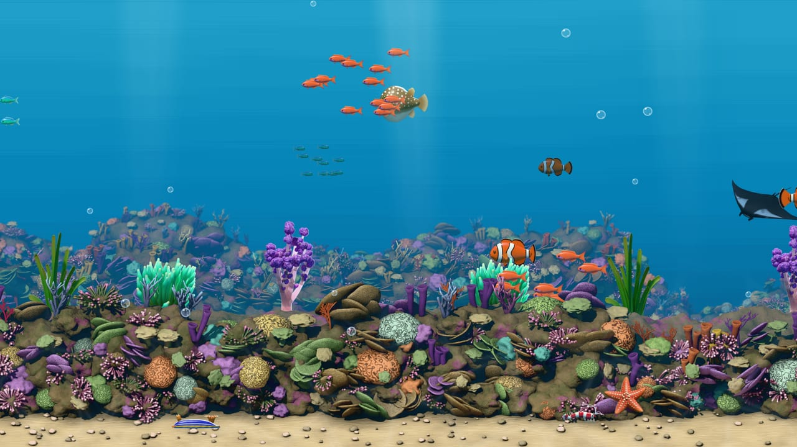
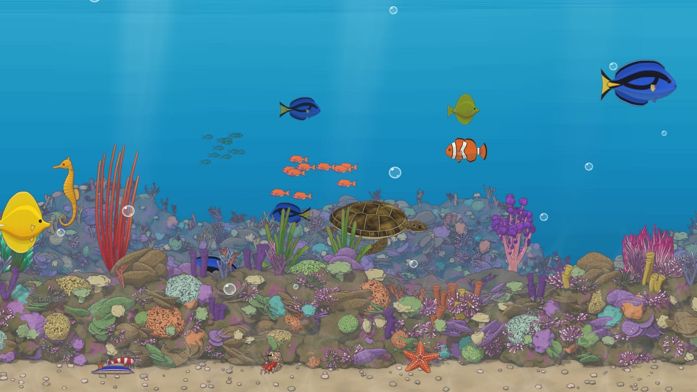
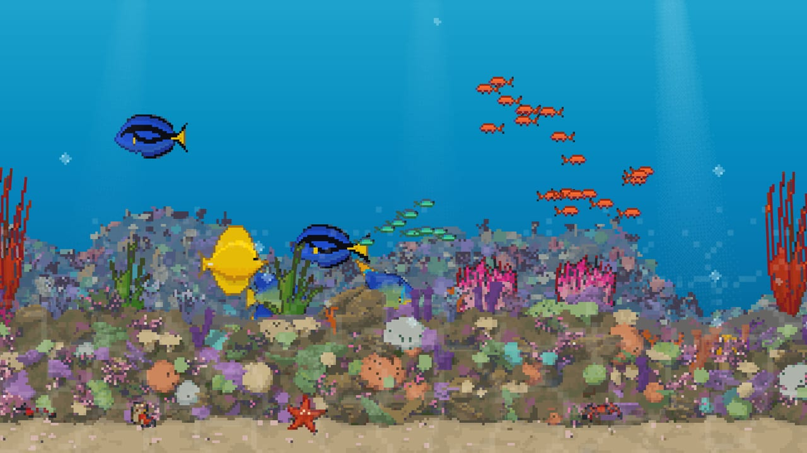
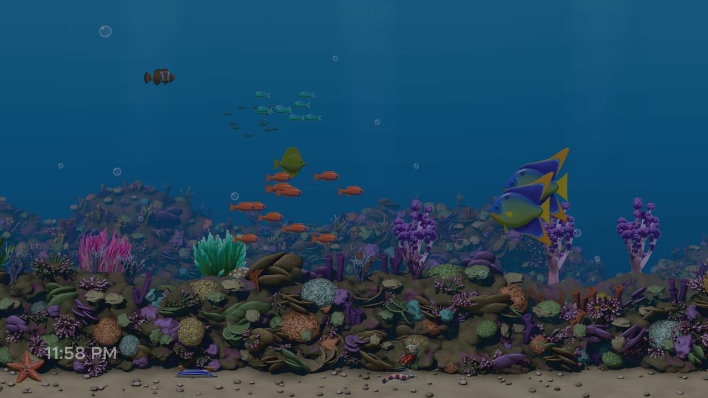

# Reef Tank

An original, open-source aquarium screensaver for Roku. A sunlit coral reef scrolls slowly past
while fish swim, schools of small reef fish drift by, crabs and shrimp wander the sand, sea whips
sway, and now and then a sea turtle, manta ray or jellyfish passes through.

It started as a home-made replacement for Roku's Aquatic Life screensaver, which Roku is retiring
on December 1, 2026. Nothing here comes from Aquatic Life: all the art is original.

> **Vibe coded, and open to pull requests.** Reef Tank was built by directing an AI coding agent
> ([Claude Code](https://claude.com/claude-code)) in conversation, not written line by line. It
> was then checked in a Roku simulator and on a real Roku. There are surely rough edges and better
> ways to do things, so [pull requests are welcome](#contributing).



| Illustrated style | Pixel art style | Night, with the clock on |
|---|---|---|
|  |  |  |

<sub>Screenshots from the browser preview, which runs the real screensaver code.</sub>

## Features

- **Three art styles from one set of 3D models:** realistic, cel-shaded illustrated, or retro
  pixel art.
- **A living reef:** clownfish, blue and yellow tangs, angelfish, a pufferfish, a seahorse, and
  schools of chromis and anthias. Crabs, a hermit crab, a sea star, a nudibranch and a cleaner
  shrimp walk the sand. A big parallax reef scrolls past with swaying sea whips, anemones,
  bubbles, light rays and dancing sunlight.
- **Rare visitors:** a sea turtle, manta ray or jellyfish every few minutes.
- **Lighting that follows the time of day,** with dusk, a moonlit blue night and dawn.
- **An optional clock** (12- or 24-hour) that moves around the screen.
- **Burn-in protection you can measure:** every pixel changes within every 5 minutes, day or
  night, and there's a test that proves it. See [docs/BURN-IN.md](docs/BURN-IN.md).
- **Light enough for cheap Rokus:** a ~3.5 MB package for all three styles, ~13–18 MB of texture
  memory per style, and few simultaneous animations. See [docs/PERFORMANCE.md](docs/PERFORMANCE.md).
- **No ads, no network access, no tracking.**

## How it's made: 3D models, down-rezzed

A Roku screensaver can't draw 3D, so all the art is made ahead of time and shipped as images. One
set of 3D models feeds all three styles:

1. **Model in code.** Python scripts build every fish, critter, plant and reef layer procedurally
   in [Blender](https://www.blender.org/): fish bodies lofted from side profiles, fins as curved
   sheets, skin patterns painted from noise, and a reef of coral pieces scattered across a strip
   that tiles seamlessly as it scrolls. Nothing is hand-drawn or downloaded
   ([art/models/](art/models/), `npm run models`).
2. **Render each model twice,** in the poses its animations need (tail and fin sweeps, plant sway):
   - with Cycles, a path tracer, for the realistic look
   - with EEVEE as a cel-shaded cartoon: light in a few flat bands, with ink outlines from
     Freestyle
3. **Down-rez into each style** (`npm run art`):
   - **Realistic:** the Cycles renders, scaled to screen size.
   - **Illustrated:** the cel-shaded renders, scaled to screen size.
   - **Pixel art:** the cel-shaded renders reduced to 6 px cells, a 320 × 180 grid on a 1080p
     screen. Every cell takes its most common color from one shared 160-color palette, which is
     picked by libimagequant and refined with k-means in the OKLab color space. Then stray pixels
     are cleaned up and an outline is drawn around each creature. Starting from cel-shaded renders
     rather than realistic ones keeps the pixel art clean instead of blotchy.
4. **Fit the Roku.** The build crops sprites, drops rows hidden behind the layers in front, stores
   soft textures at reduced size, and compresses to palette PNGs. All three styles fit in about
   3.5 MB, under Roku's 4 MB package limit.

On the Roku, SceneGraph animations move the images on the render thread: swimming, tail and fin
sweeps, plant sway, parallax scrolling, light rays and the day/night lighting. BrightScript only
runs when a fish finishes a swim and needs its next destination. The renders are committed
(`art/models/renders*/`), so building the screensaver doesn't need Blender.

## Install it on your Roku

Reef Tank isn't in the Roku Channel Store, so you install it yourself using Roku's Developer
Mode. It should work on any current Roku player or Roku TV; so far it's been tested on a Roku
Ultra (reports from other models are welcome). You need a computer on the same network with
[Node.js](https://nodejs.org/) 20 or newer and git.

1. **Turn on Developer Mode.** On the Roku remote, press **Home ×3, Up ×2, Right, Left, Right,
   Left, Right**. On the screen that appears, note the IP address, choose **Enable installer and
   restart**, accept the license, and set a password. The username is always `rokudev`.
2. **Get the code and point it at your Roku:**
   ```bash
   git clone https://github.com/ArpanDe/reef-tank.git
   cd reef-tank
   npm install
   cp .env.example .env
   ```
   Edit `.env` and set `ROKU_HOST` to your Roku's IP and `ROKU_PASSWORD` to the password you chose.
   `.env` is gitignored, so your password stays on your machine.
3. **Build and install:**
   ```bash
   npm run deploy
   ```
4. **Make it your screensaver:** on the TV, go to **Settings › Theme › Screensavers › Change
   screensaver** and choose **Reef Tank**.

### Settings

Reef Tank's settings are on the Screensavers settings screen; the wording varies by Roku OS
version. Highlight a setting and press OK to change it.

| Setting | Options |
|---|---|
| Art style | Illustrated, Realistic, Pixel art |
| Scrolling | Slow, Medium, Fast |
| Fish | Few, Some, Lots |
| Clock | Off, 12-hour, 24-hour |
| Lighting | Follow time of day, Always day, Always night |
| Rare visitors | On, Off |

To uninstall, repeat the remote sequence from step 1 and choose **Disable installer and restart**.
A Roku holds one sideloaded app at a time, so installing something else also replaces it.

## Try it without a Roku

```bash
npm install
npm run preview
```

This opens <http://localhost:6502>, which runs the real screensaver code in
[brs-engine](https://github.com/lvcabral/brs-engine), a Roku simulator for the browser. Controls on
the page switch the style, scrolling, fish, time of day, clock and visitors, and open the Settings
screen.

## Documentation

- [docs/DEVELOPMENT.md](docs/DEVELOPMENT.md): commands, dev launch options, how the code is
  organized, and Roku behaviors worth knowing about.
- [docs/BURN-IN.md](docs/BURN-IN.md): how the burn-in guarantee works and how it's tested.
- [docs/PERFORMANCE.md](docs/PERFORMANCE.md): Roku's limits, how the build stays under them, and
  measurements from a real device.
- [art/README.md](art/README.md): the art spec, for adding creatures, plants or a new style.
- [docs/STORE.md](docs/STORE.md): what publishing to the Roku Channel Store would take.

## Contributing

This is a vibe-coded hobby project, and issues and pull requests are welcome. Especially useful:
- results from other Roku models, above all inexpensive ones
- new creatures and plants
- fixes for the known rough edges:
  - small details lost at pixel-art size (crab spots, shrimp legs, jellyfish tentacles)
  - faint lines where the manta's wings meet its body in the cel-shaded style

See [CONTRIBUTING.md](CONTRIBUTING.md). Security problems: see [SECURITY.md](SECURITY.md).

## License and credits

[MIT](LICENSE), for both the code and the art.

Built with [Claude Code](https://claude.com/claude-code): the code and the scripts that model the
art were written by AI from conversation, then tested in the simulator and on a real Roku.

**Tools it stands on:**
- [brs-engine](https://github.com/lvcabral/brs-engine) by Marcelo Lv Cabral: the in-browser Roku
  simulator behind `npm run preview` and the burn-in audit.
- The [RokuCommunity](https://github.com/rokucommunity) tools:
  [BrighterScript](https://github.com/rokucommunity/brighterscript),
  [bslint](https://github.com/rokucommunity/bslint) and
  [roku-deploy](https://github.com/rokucommunity/roku-deploy).
- [Blender](https://www.blender.org/), by the Blender Foundation and community: every creature,
  plant and reef layer is built with its Python API and rendered with Cycles (realistic) and
  EEVEE with Freestyle (cel-shaded).
- [resvg-js](https://github.com/thx/resvg-js) (light rays and caustics),
  [sharp](https://sharp.pixelplumbing.com/) and [pngjs](https://github.com/pngjs/pngjs) (image
  processing). sharp's palette quantization is
  [libimagequant](https://pngquant.org/lib/), by Kornel Lesiński.

**Ideas it borrows:** the Pixel style is made from toon-shaded 3D renders, an approach
popularized by
[Dead Cells](https://www.gamedeveloper.com/production/art-design-deep-dive-using-a-3d-pipeline-for-2d-animation-in-i-dead-cells-i-)
(Motion Twin; Thomas Vasseur's write-up). Realistic renders use the
[Khronos PBR Neutral](https://gamedev.net/news/khronos-pbr-neutral-tone-mapper-released-for-true-to-life-color-rendering-of-3d-objects-r2733)
tone mapper. How it picks each pixel was shaped by
[Content-Adaptive Image Downscaling](https://johanneskopf.de/publications/downscaling) (Kopf,
Shamir and Peers, SIGGRAPH Asia 2013), [pyxelate](https://github.com/sedthh/pyxelate) (by
sedthh), and [ProPixelizer](https://propixelizer.github.io/)'s notes on outlines. Colors are
matched in [OKLab](https://bottosson.github.io/posts/oklab/), Björn Ottosson's perceptual color
space, and the palette is refined with k-means, which
[Celebi (2011)](https://doi.org/10.1016/j.imavis.2010.10.002) showed is a strong color
quantizer.

Reef Tank is not affiliated with or endorsed by Roku, Inc. Roku is a trademark of Roku, Inc.
Aquatic Life and Marine Aquarium belong to their respective owners.
